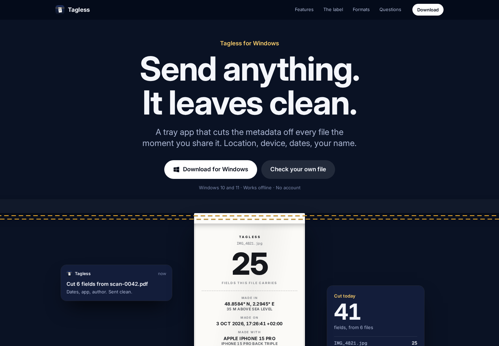

<p align="center"></p>

<h1 align="center">Tagless: anti-OSINT metadata remover for Windows</h1>
<p align="center"><b>Send anything. It leaves clean.</b><br>A Windows tray app that cuts the metadata off every file the moment you share it.</p>
<p align="center"><sub>OSINT · privacy · metadata remover · EXIF remover · EXIF · OPSEC · counter OSINT · tray app · windows</sub></p>

> **Status: v2.5.4.** The app is out — [download Tagless for Windows](https://awesomeosint.tools/tagless/).

## Why this exists

Every file you share carries a return address: the camera, the GPS point, the editor, your name. Most people never see it, everyone receives it.

## Why it is different

Metadata removers work one file at a time. Tagless sits in the tray and cleans everything you share — drop a file on it and see what it was carrying.


## The idea

Every file carries a label you never wrote: where the photo was taken, which phone, the exact second, your name and company. Tagless treats it like the care label sewn into a shirt, and cuts it off.

- **One object.** A white woven label on dark indigo denim, hanging from a gold-stitched seam.
- **One number.** How many fields the file carries.
- **One accent.** Gold thread, `#E0A32E`.


## The demo on the page

The label in the hero cycles through three sample files: it prints, the lines are struck out, scissors cut it off and a Windows-style toast confirms it.

A visitor can drop their own photo, PDF or Office file. It is read in the browser and never uploaded, and the label shows what that file really carries. **Cut the label** then stops a little over half-way and leaves the label hanging by a thread, with the download button next to it. The page reads labels; the app cuts them.


## Brand

| | |
| --- | --- |
| Denim | `#060B18` `#0A1224` `#0F1A33` `#162548` |
| Thread | `#E0A32E`, hover `#F6CB6A` |
| Label | `#FDFCF9`, ink `#15171C` |
| Type | SF Pro on Apple devices, Inter everywhere else; Geist Mono for file names |
| Voice | Short. Plain. The label metaphor: made in, made on, made with, made by |

Fonts in `assets/fonts` are Inter and Geist Mono, both under the SIL Open Font License; the licence texts sit next to them.

## Rebuild the samples

```bash
python3 tools/make-samples.py
```

```bash
node tools/build-samples.mjs
```
